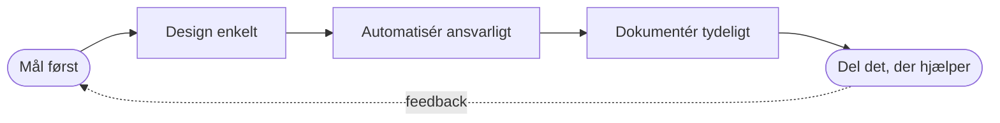

+++
title = "Iustinian Olaru - Forretningsanalytiker & softwarearkitekt"
description = "Forretningsanalytiker og softwarearkitekt i Danmark. Fra forretningsproblem til kørende software: analyse, feasibility-studier, arkitektur og C#/.NET-udvikling."
date = 2024-01-01
tags = ["Forretningsanalytiker", "Softwarearkitekt", "C#", ".NET", "Danmark", "Konsulent", "Freelancer"]
og_image = "/images/og.png"
locale = "da_DK"
availability = "Tilgængelig for konsulentopgaver og projektbaserede forløb"
pitch = "Fra forretningsproblem til kørende software, med én person, der står til ansvar for begge dele."

[[proof]]
figure = "100×"
claim = "En flaskehals i gennemstrømningen fundet i et foreslået design, før det blev bygget."
caseStudy = "/case-studies/rabbitmq-feasibility-study"

[[proof]]
figure = "Overskud"
claim = "Et makerspace, der kørte med underskud, fik overskud for første gang siden COVID."
caseStudy = "/case-studies/makerspace-management"

[[proof]]
figure = "Idé → i drift"
claim = "ESIO, en budget-app til små virksomheder, analyseret, bygget og drevet som teknisk medstifter."
caseStudy = "/case-studies/blazor-saas-platform"
+++

***Mål først. Design enkelt. Automatisér ansvarligt. Dokumentér tydeligt. Del det, der hjælper.***

