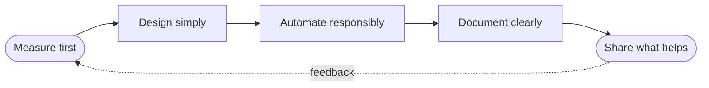

+++
title = "Iustinian Olaru - Software Developer & Consultant"
description = "Iustinian Olaru - Software Developer specializing in C#/.NET, full-stack development, distributed systems, and domain-driven design. Based in Denmark."
date = 2024-01-01
tags = ["Software Developer", "C#", ".NET", "Full Stack", "Denmark", "Consultant", "Freelancer"]
og_image = "/images/og.png"
locale = "en_US"
availability = "Available for consulting and project-based engagements"
+++

***Measure first. Design simply. Automate responsibly. Document clearly. Share what helps.***

